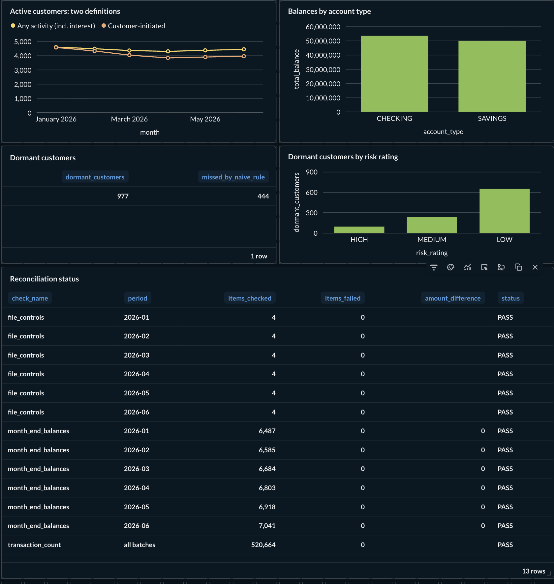
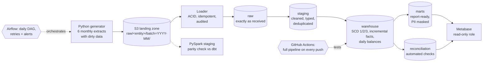
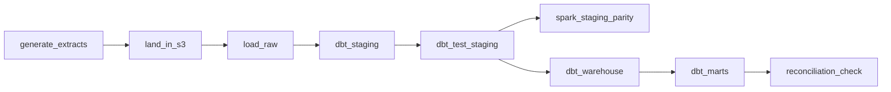
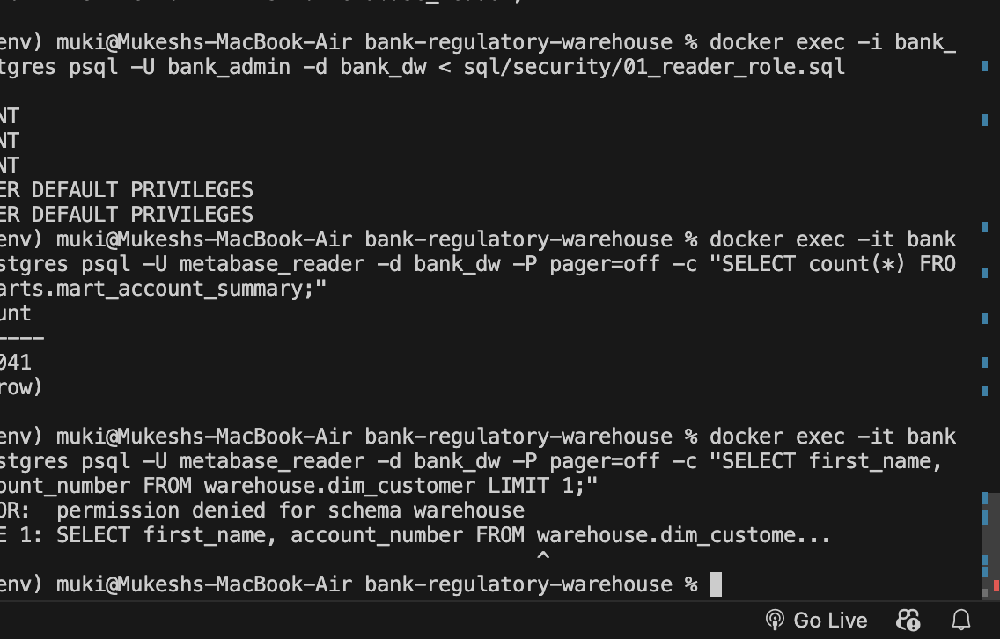

# Bank Regulatory Reporting Warehouse

[](https://github.com/mukesh132001/bank-regulatory-warehouse/actions/workflows/ci.yml)

An end-to-end data warehouse that simulates how a bank prepares data for
regulatory reporting: messy source extracts in, reconciled and auditable
numbers out. Every reported figure can be traced back to the exact line of the
exact source file it came from.



## The problem

Banks must send accurate reports to regulators and auditors. In practice,
source systems deliver duplicates, late records and inconsistent formatting;
customer details change over time; and every reported number must reconcile to
the source system and be fully traceable. This project simulates that whole
process on a laptop, including a real reconciliation failure and its fix.

## Architecture



| Layer | Role | Analogy |
|---|---|---|
| `raw` | Every extract kept exactly as received, all columns as text, plus audit columns | Data lake |
| `staging` + `warehouse` | Cleaned, typed, deduplicated, modelled with history | Data warehouse (single source of truth) |
| `marts` | Small, report-ready tables for specific users, PII masked | Data marts |

**Stack:** Python (Faker, psycopg2, boto3) · PostgreSQL 16 · dbt 1.12 · Apache Airflow 3 ·
PySpark 4 · AWS S3 (local emulator: moto) · GitHub Actions · Docker Compose · Metabase

## What it demonstrates

| Topic | Where |
|---|---|
| Data lake vs warehouse vs mart | `raw` → `staging`/`warehouse` → `marts` schemas |
| SCD Type 1 / 2 / 3 | `dim_customer`, `dim_customer_scd2`, `dim_customer_risk_scd3` |
| SQL: no transactions in 90 days | `mart_dormant_customers` |
| SQL: running account balance | `fct_account_daily_balance` (window function) |
| Preventing downstream duplicates | Cross-batch dedup in `stg_transactions`, `unique` tests, idempotent loader |
| Source ↔ warehouse reconciliation | `models/reconciliation/`, `assert_reconciliation_passes` test |
| Inconsistent balances in a report | [INCIDENT-001](docs/incident_001_balance_breaks.md) |
| Audit and lineage | `_batch_id`, `_source_file`, `_source_row`, `_loaded_at`, `audit.load_log`, dbt lineage graph |
| Securing sensitive data | Masking macros in marts + read-only database role |
| Different KPIs from the same data | [KPI definitions](docs/kpi_definitions.md), `mart_active_customer_kpis` |
| "Monthly load slowed 2h → 8h" | [Performance investigation](docs/performance_investigation.md) |
| ACID | One transaction per batch in `loader/load_raw.py`, proven with `--simulate-crash` |
| Orchestration | Airflow DAG `bank_regulatory_pipeline`: daily schedule, retries, failure alerts, single-month re-runs |
| CI/CD | [GitHub Actions](.github/workflows/ci.yml) runs the full pipeline and every test on each push |
| Cloud data lake landing | `loader/land_to_s3.py` → `s3://…/raw/<entity>/batch=YYYY-MM/`, loader reads with `--source s3` |
| Spark | `spark/stage_transactions.py`: explicit schemas, quarantine, cross-batch dedup, Parquet, parity vs dbt |
| Incremental loading | `fct_transactions` merges only newly loaded rows ([benchmark](benchmarks/run_incremental_benchmark.py)) |
| Secrets management | `.env` (git-ignored) + GitHub Actions secrets; no password in the code |

## How it runs daily

The Airflow DAG `bank_regulatory_pipeline` ([`airflow/dags/`](airflow/dags/bank_regulatory_pipeline.py))
runs the whole pipeline every day. In a real bank the first step is the core
banking system dropping its files; here the generator plays that role.



<!-- After your first Airflow run, save a screenshot of the Graph view as
     docs/images/airflow_dag.png and replace this comment with:
      -->

- **Retries:** every task retries twice, 5 minutes apart.
- **Failure alerts:** after the last retry, a callback logs the failure and posts it to
  `ALERT_WEBHOOK_URL` (any Slack-compatible webhook) when one is configured.
- **Quality gates:** staging tests run before anything is built on top of staging, and
  the run only turns green if the reconciliation checks pass.
- **Re-run one month safely:** trigger the DAG with config `{"batch": "2026-03"}`. Only that
  month is re-landed in S3 and re-loaded (the loader replaces a batch in one transaction),
  then dbt rebuilds everything downstream and reconciliation must pass again.
- **One run at a time** (`max_active_runs=1`), no backfill of past dates (`catchup=False`).

**CI:** [GitHub Actions](.github/workflows/ci.yml) runs the same steps on every push and pull
request against a fresh Postgres and a local S3 emulator: land in S3, load from S3, reload a
month (idempotency), simulate a crash (rollback), `dbt build` with every test, an incremental
rebuild, the Spark parity check, the incremental benchmark and the read-only role check. A
second job imports the DAG with Airflow 3.3.2 and checks its structure, retries and alerting.

## Highlights

### Reconciliation caught a real bug

The first full run failed the reconciliation test: warehouse balances did not
match the core banking system's official balances, with 414 accounts off by a
total of 186,859.24 by June. File-level controls all passed, so the problem was
inside the pipeline. Lineage columns showed duplicate transactions with the same
`transaction_id` but different `_batch_id`: the source system re-sends some
transactions in the following month's file, and deduplication only worked
within a single batch.

Fixed by deduplicating across all batches, and prevented from recurring with a
uniqueness test. All 520,664 transactions now exist exactly once, and every
account's month-end balance matches the official figure to the cent.
**Full write-up: [INCIDENT-001](docs/incident_001_balance_breaks.md).**

### SCD Type 2: full customer history

Customer `C002852`, reconstructed from monthly snapshots:

| Version | Change | Valid from | Valid to |
|---|---|---|---|
| 1 | Dennishaven, VI, MEDIUM risk | 2020-03-24 | 2026-03-29 |
| 2 | Risk raised to HIGH | 2026-03-29 | 2026-05-11 |
| 3 | Moved to East Elizabeth, DE | 2026-05-11 | 2026-06-13 |
| 4 | Risk lowered to LOW (current) | 2026-06-13 | 9999-12-31 |

`fct_transactions` uses a point-in-time join, so each transaction carries the
risk rating that was valid *when it happened*.

### The "dormant customer" trap

Savings accounts receive monthly interest from the system even when the
customer does nothing. A naive "no transactions in 90 days" rule would have
missed **444 of the 977** dormant customers (45%). The report counts only
customer-initiated activity.

### One dataset, two KPI definitions

"Active customers" counted as *any activity* vs *customer-initiated*: the gap
grows from 21 in January to 484 in June. The first definition hides a real
decline in engagement. Both are documented in
[KPI definitions](docs/kpi_definitions.md).

### Performance: indexing vs partitioning (6M rows)

| Operation | No index | Indexed | Partitioned by month |
|---|---|---|---|
| Monthly report | 0.366s | 0.507s (1.4x slower) | 0.208s (1.8x faster) |
| Account lookup | 0.255s | 0.001s (202x faster) | 0.001s (243x faster) |
| Monthly reload | 3.396s | 10.888s (3.2x slower) | 3.149s (1.1x faster) |

Indexes made lookups 200x faster but made the monthly reload 3.2x slower,
a realistic cause of a load creeping from 2 to 8 hours. Partitioning matched the
indexed lookup speed with a 3.5x faster reload than the indexed table.
**Full analysis: [Performance investigation](docs/performance_investigation.md).**

### Spark and dbt must agree

`spark/stage_transactions.py` rebuilds the transactions staging step in PySpark: an explicit
schema (no inference), `try_` casts with a quarantine table for rows that fail validation,
the same cross-batch deduplication as the INCIDENT-001 fix (`row_number()` over
`transaction_id`, first copy received wins) and Parquet output partitioned by month. With
`--check-against-postgres` it compares row counts, distinct ids, totals and per-batch counts
with dbt's `stg_transactions` and fails if anything differs. Airflow and CI both run it.

### Incremental loading

`fct_transactions` is an incremental dbt model: after the first build, a run only processes
transactions whose raw row was loaded since the last run and merges them on
`transaction_id`. Reloading a month refreshes exactly that month. If the table ever drifts
from raw, the reconciliation transaction count fails the pipeline until a `--full-refresh`.
`benchmarks/run_incremental_benchmark.py` times incremental vs full rebuild for a new month
and checks both give an identical table (results: `benchmarks/results/incremental.md`, also
shown in each CI run's summary).

### Security: masking plus access control

Marts expose only masked values (`******6127`, `R*** T***`, `ro***@yahoo.com`),
enforced by a test that fails if a full account number ever leaks. Metabase
connects with a read-only role that cannot even see the warehouse schema:



## Dirty data simulated on purpose

- Duplicate transactions within a file, and re-sent in the next month's file
- Late-arriving transactions (last month's activity in this month's file)
- Messy customer fields: extra spaces, inconsistent casing, missing emails
- Customer changes over time: address moves, risk rating changes, email updates
- Dormant customers, with system interest that hides their dormancy

## Design decisions

- **Raw stores everything as text.** Raw never rejects a row because of a bad
  date or number; typing and validation happen in staging, where they can be tested.
- **SCD Type 2 is rebuilt from retained snapshots** rather than dbt snapshots.
  Because raw keeps every extract, history can be regenerated at any time; a
  lost snapshot table cannot.
- **Idempotency is not deduplication.** Reloading a batch replaces it (safe to
  rerun), but raw deliberately keeps duplicates that exist in the source file.
  Removing them is the warehouse's job.
- **Money is handled as integer cents** in the generator and `NUMERIC` in the
  database, never floating point.
- **Fixed random seed**, so every run produces identical data and bugs are reproducible.

## Run it yourself

Requires Docker Desktop and Python 3.12 (Java 17+ only if you run the Spark job outside Docker).

### 1. Settings (once)

```bash
git clone https://github.com/mukesh132001/bank-regulatory-warehouse.git
cd bank-regulatory-warehouse
cp .env.example .env        # then replace every "change-me" value in .env
```

`.env` is git-ignored. Docker Compose, the Python scripts and `scripts/dbt.py` all read it,
so no password lives in the code. Compose refuses to start if a required value is missing.

> Upgrading from an older checkout? The old Postgres volume still has the old password.
> Either put that password in `.env` or reset the volume once with `docker compose down -v`.

### 2a. Run everything with Airflow

```bash
docker compose up -d --build     # warehouse, S3 emulator, Metabase, Airflow
```

Open Airflow at `localhost:8080` (user/password from `.env`), un-pause
`bank_regulatory_pipeline` and trigger it. To re-run a single month, use
"Trigger DAG w/ config" with `{"batch": "2026-03"}`.

### 2b. Or run the steps yourself

```bash
python3.12 -m venv .venv
source .venv/bin/activate                  # Windows: .venv\Scripts\activate
pip install -r requirements.txt

docker compose up -d postgres s3 metabase
python data_generator/generate_data.py     # 6 monthly extracts
python loader/land_to_s3.py --create-bucket    # land them in the S3 landing zone
python loader/load_raw.py --source s3      # load the raw layer (or omit --source for local files)

python scripts/dbt.py build                # all models + all tests (dbt with .env settings)
python scripts/dbt.py docs generate
python scripts/dbt.py docs serve --port 8081   # lineage graph at localhost:8081

python spark/stage_transactions.py --check-against-postgres   # PySpark staging + parity

# read-only role for dashboards (after dbt has created the schemas)
set -a; source .env; set +a
docker exec -i bank_postgres psql -U "$POSTGRES_USER" -d "$POSTGRES_DB" \
    -v reader_password="$METABASE_READER_PASSWORD" < sql/security/01_reader_role.sql

python benchmarks/run_benchmark.py              # optional: indexing vs partitioning
python benchmarks/run_incremental_benchmark.py  # optional: incremental vs full rebuild
```

Metabase runs at `localhost:3000`. Connect with host `postgres`, database
`bank_dw`, user `metabase_reader`.

### Using real AWS S3

Remove `AWS_ENDPOINT_URL` from `.env`, set `S3_BUCKET` to your bucket and provide AWS
credentials the usual way (profile or environment). The same code runs unchanged.

### CI secrets

CI needs no setup: it creates a one-time random password for its throwaway database. To
use your own, add a repository secret `CI_POSTGRES_PASSWORD`
(Settings → Secrets and variables → Actions).

## Repository layout

```
├── .github/workflows/  CI: full pipeline + DAG integrity on every push
├── airflow/
│   ├── dags/           bank_regulatory_pipeline (daily, retries, alerts)
│   └── Dockerfile      Airflow 3 image with the project's own virtualenv + Java
├── common/             settings from .env, S3 landing-zone layout
├── data_generator/     fake banking extracts with deliberate dirty data
├── loader/             S3 landing upload + ACID, idempotent, audited raw loader
├── spark/              PySpark staging job with parity check vs dbt
├── dbt_project/
│   ├── models/         staging, warehouse (incremental facts), marts, reconciliation
│   ├── macros/         schema naming, PII masking
│   └── tests/          SCD integrity, masking, reconciliation
├── scripts/            dbt wrapper that reads .env
├── sql/                schema setup and read-only security role
├── benchmarks/         indexing vs partitioning, incremental vs full rebuild
├── tests/              Airflow DAG integrity tests
├── docs/               incident report, KPI definitions, performance write-up
├── .env.example        every setting, no real secrets
└── docker-compose.yml
```

## Possible next steps

- Apply monthly partitioning to the real raw and fact tables
- Read the landing zone directly from Spark (`s3a://`) and run the job on EMR or Databricks
- Deploy the DAG to a managed Airflow (Amazon MWAA or Astronomer)
- Data contracts on the source extracts, so schema changes are caught before loading
